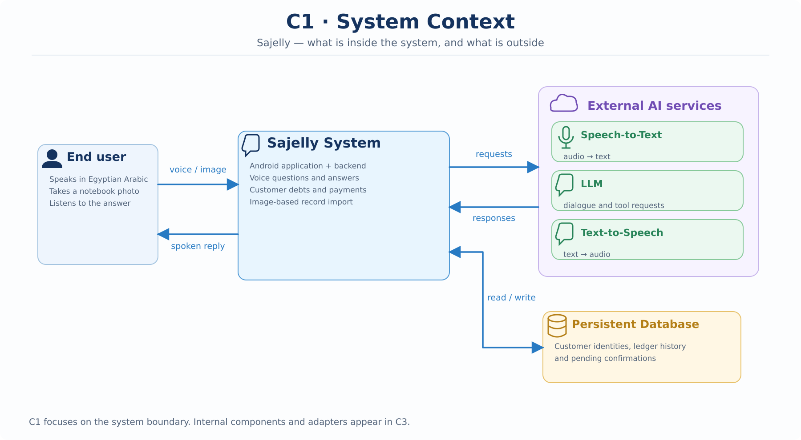
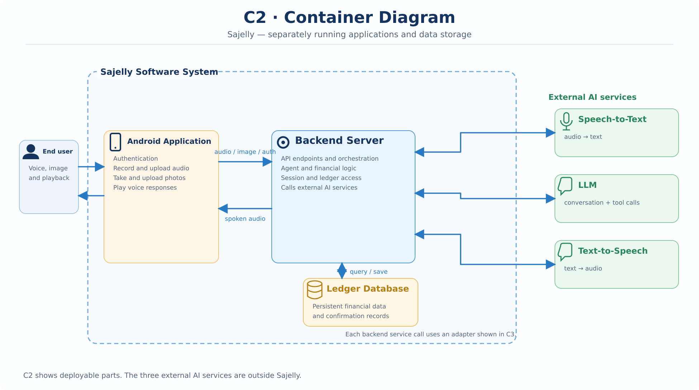
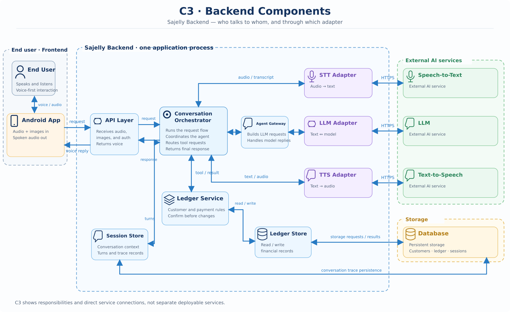
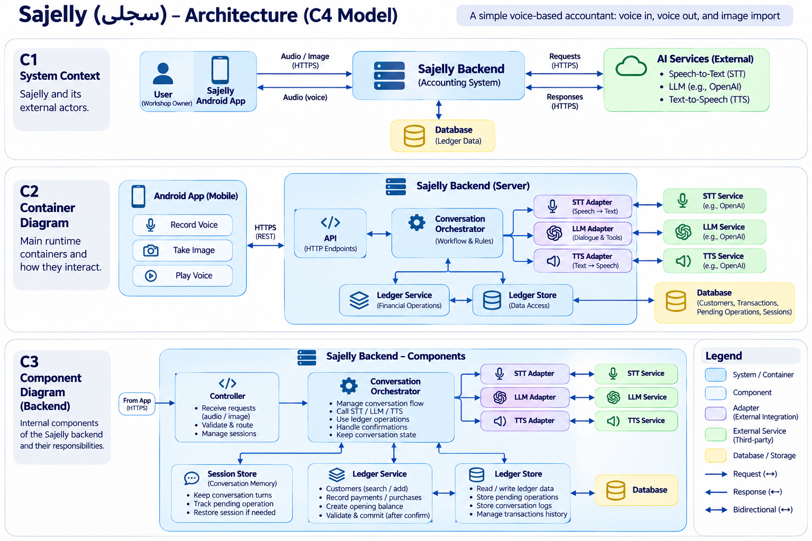

# سجلى (Sajelly) — Backend Architecture

**Version:** 0.3
**Status:** Proposed for review
**Scope:** Backend only. The Android app appears at the boundary; its interface is described in the [product definition](../../../docs/product_definition.md).

> *Raise your words, not your voice. It is rain that grows flowers, not thunder.*
> This document is written in that spirit — plainly, and with care. It prefers a clear sentence to a loud one.

## Related documents

- Product intent — [`docs/product_definition.md`](../../../docs/product_definition.md)
- System behavior and requirements — [`docs/system_requirements.md`](../../../docs/system_requirements.md)
- Diagrams — [`diagrams/`](diagrams/)
- Overview deck — [`docs/sajelly_proposal.pptx`](../../../docs/sajelly_proposal.pptx) · [`docs/sajelly_proposal.pdf`](../../../docs/sajelly_proposal.pdf)

---

## 1. What this document is

This document describes the proposed technical structure of the Sajelly backend. It takes product intent from the [product definition](../../../docs/product_definition.md) and expected behavior from the [system requirements](../../../docs/system_requirements.md). It does not redefine either; where the two disagree with this design, those documents lead.

The first-release boundary is owned by [System Requirements §12](../../../docs/system_requirements.md#12-first-release-and-later-work). This design shows how that release can work, and where later work — confirmed writes and notebook imports — will fit without reshaping what comes first.

One principle guides the whole design: *one small backend, clear responsibilities, and no infrastructure we cannot yet justify.*

## 2. System boundary

Two kinds of boundary are easy to confuse: what we *own and build*, and what runs in a *separate process*. They are not the same line, and the one that matters here is ownership.

**What we build — the Sajelly system.** Two containers, both our responsibility:

- **The backend application.** One process holding the API, the Conversation Orchestrator, the Ledger Service, the stores, and the *adaptation layer*. The adapters that speak to external AI services are our code — written, tested, and shipped inside this process. They face outward, but they are ours.
- **The database.** A separate container from the backend application, yet still ours. We own its schema, its access, and the data it holds: customer details, financial history, pending operations, and the conversation trace. It runs as its own process so that persistence survives restarts and can scale on its own terms — not because it falls outside our responsibility.

**What we depend on but do not build — external AI providers.** Speech-to-text, a language model, text-to-speech, and — later — image understanding. These are third-party systems beyond our boundary. The backend reaches them only through the adapters, so no other part of the code depends on a particular provider.

**At the edge — the client.** The app sends authenticated audio and image requests and plays the spoken reply. It calculates no balances and decides nothing about what to save. Its internal behavior is out of scope here; see the [product definition](../../../docs/product_definition.md).

So the boundary is drawn by ownership, not by process. The adaptation layer is backend code even though it talks outward; the database is a backend responsibility even though it runs as its own container. Only the AI providers are truly external. In the diagrams, a line means two parts communicate — not that they share ownership of data.

## 3. The system in four views (C4)

These views move from the widest frame to the narrowest. A reader can stop at the level that answers their question. The polished sources live in [`diagrams/`](diagrams/).

**Reading the diagrams.** A single arrow is a one-way message or request; a double arrow is a request and its response. A line means two parts talk to each other — not that they share data.

### 3.1 Context (C1) — who the backend talks to

*The backend sits between the app and the services it depends on. Source: [`diagrams/C1_system_context.svg`](diagrams/C1_system_context.svg).*

### 3.2 Containers (C2) — the moving parts

*The containers we run — the backend application and the database — alongside the app that calls in and the external AI providers we depend on. Source: [`diagrams/C2_containers.svg`](diagrams/C2_containers.svg).*

### 3.3 Components (C3) — inside the backend

*The backend's internal components and the adapters that cross its boundary. Responsibilities are listed in [§4](#4-components-and-responsibilities). Source: [`diagrams/C3_components.svg`](diagrams/C3_components.svg).*

### 3.4 Overview

*A single-page picture for quick reference. Source: [`diagrams/C4_intial_architecture_overview.png`](diagrams/C4_intial_architecture_overview.png).*

## 4. Components and responsibilities

A component is a responsibility, not a server. Several of these can begin life as a few Python modules in one backend process. The point of naming them is to keep each concern in one place.

| Component | Owns | Does not own |
| --- | --- | --- |
| **API** | Receives audio, image, and login requests; identifies the signed-in user; returns audio | Conversation decisions or financial rules |
| **Conversation Orchestrator** | Coordinates each turn — transcribe, ask the agent, run approved tools, speak — and tracks the current operation | Balance calculations or database queries |
| **Speech-to-Text Adapter** | Turns an audio recording into text through a provider | Interpreting financial intent |
| **Agent Gateway** | Sends instructions, context, and available tools to the LLM; turns model output into a clear reply or a requested tool call | Direct database writes or authorization |
| **Text-to-Speech Adapter** | Turns the final reply into spoken Egyptian Arabic | Choosing the answer |
| **Session Store** | Keeps conversation turns, their links to operations, and context across restarts | Financial truth |
| **Ledger Service** | Finds customers, calculates balances, checks rules, prepares changes, verifies confirmation, and commits | Speaking to the LLM or choosing a voice |
| **Ledger Store** | Reads and writes the financial data the Ledger Service needs | Business decisions |
| **Photo Import Handler** *(later)* | Receives candidate entries for review and passes approved ones to the Ledger Service | Treating OCR output as approved |
| **Image Adapter** *(later)* | Sends notebook photos to an image model and returns possible entries | Deciding whether entries are correct |

**Two kinds of memory.** The Session Store remembers the *conversation*. The Ledger Store remembers the *money*. The language model's memory is never the source of financial truth.

## 5. Four runtime flows

The flows describe what the backend does once a request arrives. The app's part is only the trigger.

### Flow A — Ask about money (first release)

1. The app uploads a complete short recording.
2. The Orchestrator asks the Speech-to-Text Adapter for a transcript and loads the session context.
3. The Agent Gateway asks the LLM what the user needs. For a balance question, the model requests a ledger query.
4. The Orchestrator passes that query to the Ledger Service, which answers through the Ledger Store.
5. The Agent Gateway receives the result and produces a short Arabic answer.
6. The Text-to-Speech Adapter returns audio. The backend sends audio only; the app plays it.
7. The backend keeps the transcript, the tool request and result, and the reply for inspection. No financial record changes.

### Flow B — Missing information

1. A customer or request is ambiguous.
2. The agent asks the Ledger Service for the available customer matches, if needed.
3. The agent asks one short question in Egyptian Arabic; the backend speaks it.
4. The next recording continues the same session; the Session Store supplies the earlier context.
5. No write happens merely because the agent believes it understood.

### Flow C — Record a payment with confirmation (later slice)

1. The agent gathers the necessary details and identifies the customer.
2. It requests a *proposal*, not a write. The Ledger Service checks the numbers and creates a pending operation with fixed details in the database.
3. Sajelly speaks the exact proposed change and asks for confirmation.
4. The user records an answer such as *أيوه*, *سجّل*, or *تمام*. That transcript is saved as a new turn linked to the pending operation.
5. The LLM interprets the reply into one limited decision: confirm, reject, unclear, or change requested. Different phrases may carry the same meaning.
6. Only the Ledger Service may commit. Before it does, it checks that the operation still exists, that the user was asked about those exact details, that this is a fresh confirming turn for that operation, that the operation has not changed or already been used, and that the financial rules still hold. An unclear reply earns another question, not a guess.
7. After the database confirms the commit, Sajelly says the change was recorded. If saving fails, it must not claim success.
8. The Ledger Store keeps the entry and a trace back to its proposal and confirming turn. Corrections add history; they do not erase the original.

*A limit worth stating plainly:* a model returning `confirm` does not prove that the user confirmed. The backend must hold the actual user turn linked to that specific proposal. The interpretation can still be wrong — which is why the audio, the transcripts, and the tests matter. No second agent is needed in this first design.

Across restarts, pending operations remain in the database. On return, the system repeats the proposed change before accepting a new confirmation; a bare "yes" from a different conversation is not authorization.

### Flow D — Import a notebook photo (later slice)

1. The app sends a photo.
2. The backend stores it and asks the image service for candidate entries.
3. Candidates are marked unreviewed — never saved as financial transactions.
4. A reviewer compares each entry with the photo, corrects mistakes, and accepts or rejects them one by one.
5. Only accepted entries pass to the Ledger Service and become records, each referencing the photo.

## 6. Proposed technology

The stack is chosen to serve the principle in §1: small, testable, and free of infrastructure we cannot yet justify. Nothing here asks for more than one backend process.

| Concern | Choice | Why it fits |
| --- | --- | --- |
| Language | **Python** | One readable language across the backend; a natural fit for the adapters-and-services shape. |
| API routing | **FastAPI** | Declares the request surface — audio, image, auth — with typed models, and calls external services comfortably with async. Home of the **API** component. |
| Database modeling | **SQLModel** | Defines the ledger and session tables as typed models over SQL without hiding it — which suits the plain read/write role of the **Ledger Store** and **Session Store**. |
| Testing | **pytest** | Small, fast tests. Because the adapters are seams, tests need not call real providers (see **AD-04**). |
| Quality checks | **ruff** (lint and format) and **mypy** (static types) | Keep the code tidy and the types honest before it runs. |

The external AI providers remain outside our build; the backend meets them only through the adapters. The database runs as its own container, yet its schema and access are part of this stack — defined with SQLModel and reached through the stores.

## 7. Agreed architecture decisions

| ID | Decision | Why |
| --- | --- | --- |
| **AD-01** | One app; one backend application | Small enough to understand, test, and ship |
| **AD-02** | Record a short complete clip; upload after stop | Simple turn handling and good inputs for debugging |
| **AD-03** | Start with speech-to-text → LLM → text-to-speech | Inspect each step; compare with a realtime approach later |
| **AD-04** | Reach external AI and speech services through small adapters | Tests need not call real providers |
| **AD-05** | Return only audio to the user's screen | Voice is the interface; keep the screen minimal |
| **AD-06** | Save turns, model and tool results, and diagnostic audio during evaluation | Understand failures; control access and retention |
| **AD-07** | Keep the ledger and pending proposals in persistent storage | Financial history and unfinished requests survive restarts |
| **AD-08** | The agent proposes and interprets; the Ledger Service validates and commits | Keep the model from changing money records directly |
| **AD-09** | Use the same backend for notebook import | Avoid a separate service for one feature |

## 8. What we will not build yet

No streaming audio, realtime integration, orchestration frameworks, multi-agent checking, push notifications, offline mode, dashboards, a product catalog, or microservices. These are options to weigh later, not conditions for starting.

## 9. Safety and inspection

- Every committed write needs a matching confirmed proposal (**SAFE-001–SAFE-008** in the [system requirements](../../../docs/system_requirements.md)).
- Balances come from the saved history, never from the model (**DATA-002–DATA-004**).
- Similar customer names may exist; the system may not silently choose between them (**CUS-001–CUS-006**).
- Voice recordings and customer financial data are sensitive. During testing, keep access restricted and decide a retention period before collecting real recordings. Diagnostic audio is for review, not a standing requirement.
- A failed external service or an unclear reply must never be reported as a completed financial operation.

## 10. First runnable slice and Definition of Done

**Slice 1 — ask the accountant about a known balance.** No writes, imports, or customer registration yet.

Given a small set of verified customer records, when the user asks in Egyptian Arabic, Sajelly retrieves the balance and speaks the correct amount. If the name matches several people, it asks which person the user means rather than guessing.

Done when:

- It runs end to end on an Android phone with internet.
- The backend accepts a recording, returns audio, and the app can play and stop it.
- Known balances match the database, and customer ambiguity is handled.
- For a failed test, we can follow transcript → tool call → database result → spoken reply.
- No financial write tool is enabled in this slice.

## 11. Questions deferred until the relevant slice

- Which sign-in method is easiest for the authorized roles?
- How long do we keep raw recordings and session logs, and who may inspect them?
- Which model or provider handles Egyptian Arabic reliably and at acceptable cost?
- What fields are actually present in the real notebook photos?

None of these block the first architectural picture or the first runnable slice.
