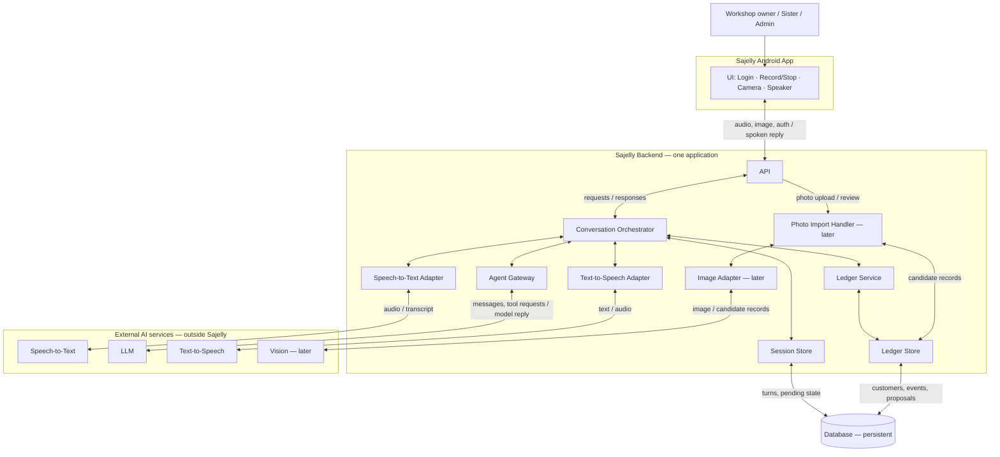

# سجلى (Sajelly) — Architecture Draft

**Version:** 0.1 · **Status:** Proposed for review · **Input:** [`requirements.md`](requirements.md)

## 1. What we are building

Sajelly helps a workshop owner manage money customers owe him by speaking Egyptian Arabic. It should behave like a helpful accountant: listen, ask when unsure, look up records, and never change money records without confirmation.

The first release proves **one complete path**: ask a question by voice and hear an answer from known records. The design also shows where confirmed writes and notebook photos will fit later.

**Design rule:** One small backend, clear responsibilities, no unnecessary infrastructure.

## 2. System boundary

There are four parties:

1. **Android app (Sajelly):** login, record/stop, play speech/stop playback, take/upload a photo. It does not calculate balances or decide what to save.
2. **Sajelly backend (our software):** receives requests, coordinates the conversation, runs financial checks, and controls access to records.
3. **External AI services:** speech-to-text, language model, text-to-speech, and (later) image understanding. We access them through small adapters inside the backend.
4. **Database:** keeps customer details, financial history, pending operations, and the conversation trace. The database is separate from the backend process.

**Arrow convention:** `-->` is a one-way message or request; `<-->` means request and response. Lines show *communication*, not shared ownership of data. The database and external model services are **not** part of the backend process.

## 3. Backend responsibilities

| Part | Owns | Does **not** own |
| --- | --- | --- |
| **API** | Receives audio, image and login requests; identifies the signed-in user; returns audio | Conversation decisions or financial rules |
| **Conversation Orchestrator** | Coordinates each turn: transcribe → ask agent → execute approved tools → speak; keeps track of the current operation | Balance calculations or database queries |
| **Speech-to-Text Adapter** | Converts an audio recording to text through a provider | Interpreting financial intent |
| **Agent Gateway** | Sends instructions, conversation context and available tools to the LLM; turns model output into a clear reply or a requested tool call | Direct database writes or authorization |
| **Text-to-Speech Adapter** | Converts the final reply into spoken Egyptian Arabic | Choosing the answer |
| **Session Store** | Keeps conversation turns, their links to operations, and context across app restarts | Financial truth |
| **Ledger Service** | Finds customers, calculates balances, checks rules, prepares changes, checks confirmation, commits changes | Speaking to the LLM or choosing a voice |
| **Ledger Store** | Reads and writes the financial data required by the Ledger Service | Business decisions |
| **Photo Import Handler (later)** | Receives candidate entries for review and passes approved entries to Ledger Service | Treating OCR output as approved |
| **Image Adapter (later)** | Sends notebook photos to an image model and returns possible entries | Deciding whether entries are correct |

**Two forms of memory:** Session Store remembers the *conversation*. Ledger Store remembers the *money*. The LLM's memory is never the source of financial truth.

A logical component does **not** mean a separate server, package, framework, or class. We can start with a few Python modules in one backend process.

## 4. Four runtime flows

### Flow A — Ask about money (first release)

1. Father taps **Record**, speaks, then taps **Stop**.
2. App uploads the complete short recording to the backend.
3. Orchestrator asks Speech-to-Text Adapter for a transcript and loads the session context.
4. Agent Gateway asks the LLM what the user needs. For a balance question, the model requests a ledger query.
5. Orchestrator passes the requested query to Ledger Service; Ledger Service gets the answer through Ledger Store.
6. Agent Gateway receives the tool result and produces a short Arabic answer.
7. Text-to-Speech Adapter returns audio; backend sends **audio only** to the app; app plays it. Father can stop playback.
8. Backend retains the transcript, tool request/result and reply for inspection. No financial record changes.

### Flow B — Missing information

1. Father mentions a customer, but the name or request is ambiguous.
2. Agent requests available customer matches through the Ledger Service if needed.
3. The agent asks one short question in Egyptian Arabic; backend converts it to speech.
4. Father's next recording continues the same session; Session Store provides the earlier context.
5. No financial write occurs just because the agent thinks it understood the customer.

### Flow C — Record a payment with confirmation (later slice)

1. Father describes a purchase or payment; the agent gathers the necessary details and identifies the customer.
2. The agent requests a **proposal**, not a database write. Ledger Service checks the numbers and creates a **pending operation ID** with fixed details in the database.
3. Sajelly **speaks the exact proposed change** and asks for confirmation.
4. Father records an answer such as “أيوه”, “سجّل”, or “تمام”. The next transcript is saved as a new user turn linked to the pending operation.
5. The LLM interprets that reply into a limited decision: **confirm / reject / unclear / change requested**. Different natural phrases can mean the same decision.
6. **Only Ledger Service may commit.** It checks that the operation still exists, the user was asked about those exact details, this is a fresh confirming turn for that operation, the operation has not changed or already been used, and financial rules still hold. Unclear replies cause another question.
7. After the database confirms a successful commit, Sajelly says the change was recorded. If saving fails, it must not claim success.
8. Ledger Store keeps the financial entry and a trace back to its proposal and confirming turn. Corrections add history; they do not erase the original record.

**Important limit:** A model returning `confirm` does not prove the father confirmed. The backend must have the actual user turn linked to the specific proposal. The interpretation can still be wrong, which is why audio/transcripts and tests matter. No second agent is needed in this first design.

**Across restarts:** Pending operations remain in the database. On return, the system should repeat the proposed change before accepting a new confirmation; it must not treat a bare “yes” to a different conversation as authorization.

### Flow D — Import a notebook photo (later slice)

1. Sister takes a photo and sends it from Sajelly.
2. Backend stores the photo and gets **candidate entries** from the image service.
3. Candidates are marked **unreviewed**, not saved as financial transactions.
4. Administrator compares each entry with the photo, corrects mistakes, and accepts or rejects entries one by one.
5. Only accepted entries are passed to Ledger Service and become financial records, with a reference to the photo. Sister self-review can come later.

## 5. Agreed architecture decisions

| ID | Decision | Why |
| --- | --- | --- |
| **AD-01** | One Android app; one backend application | Small enough to understand, test and ship |
| **AD-02** | Record a short complete audio clip; upload after Stop | Simple turn handling and good inputs for debugging |
| **AD-03** | Start with speech-to-text → LLM → text-to-speech | Inspect each step; compare with Realtime later |
| **AD-04** | Use small adapters for external AI/speech services | Tests need not call real providers |
| **AD-05** | Return only audio to the father's screen | Voice is the interface; keep the screen minimal |
| **AD-06** | Save conversation turns, model/tool results and diagnostic audio during evaluation | Understand failures and improve the model; control access and retention |
| **AD-07** | Keep the ledger and pending proposals in persistent storage | Financial history and unfinished requests survive app restarts |
| **AD-08** | The agent proposes and interprets; Ledger Service validates and commits | Prevent the model from directly changing money records |
| **AD-09** | Use the same backend for notebook import | Avoid a separate service for one feature |

## 6. Things we intentionally will not build yet

No streaming audio, Realtime integration, LangChain, multi-agent checking, push notifications, offline mode, dashboards, product catalog, or microservices. These are options to evaluate later, not prerequisites.

## 7. Safety and inspection

- Every committed write needs a matching confirmed proposal (**SAFE-001–SAFE-008**).
- Balances come from the saved financial history, not the model (**DATA-002–DATA-004**).
- Similar customer names may exist, but the system cannot silently choose between them (**CUS-001–CUS-006**).
- Voice recordings and customer financial data are sensitive. During the test phase, keep access restricted and decide an explicit retention period before collecting real recordings. Diagnostic audio is for review, not a permanent requirement.
- A failed external service or unclear reply must not be reported as a completed financial operation.

## 8. First runnable slice and Definition of Done

**Slice 1: Ask the accountant about a known balance.** No writes, imports, or customer registration yet.

**Given** a small set of verified customer records, **when** the father presses Record, asks in Egyptian Arabic, and presses Stop, **then** Sajelly retrieves the balance and speaks the correct amount. The user can stop playback. If the name matches several people, Sajelly asks which person he means rather than guessing.

**Done when:**
- It runs end-to-end on an Android phone with internet.
- The UI records, uploads, plays audio and stops playback.
- Known balances match the database; customer ambiguity is handled.
- We can inspect transcript → tool call → database result → spoken reply for a failed test.
- No financial write tool is enabled in this slice.

## 9. Questions deferred until the relevant slice

- Which sign-in method is easiest for father and sister?
- How long do we keep raw recordings and session logs, and who can inspect them?
- Which model/provider handles Egyptian Arabic reliably and at acceptable cost?
- What exact fields are present in the real notebook photos?

These do not block the first architectural picture or the first runnable slice.
